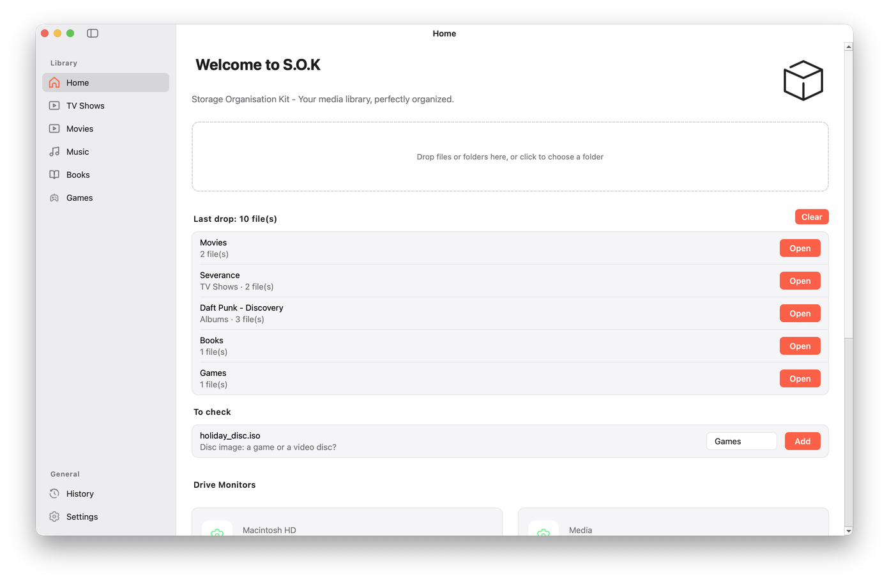
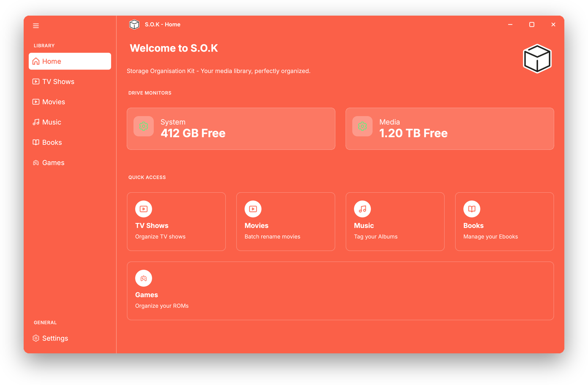
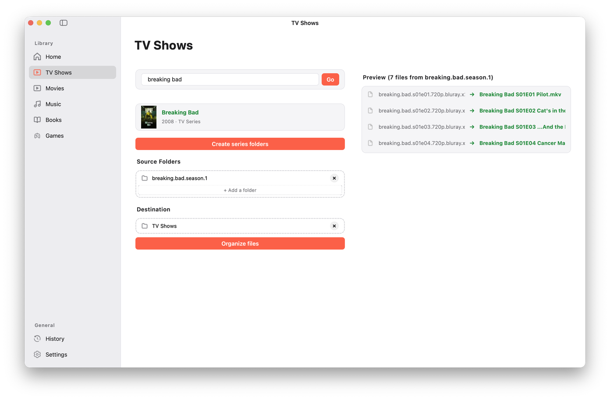
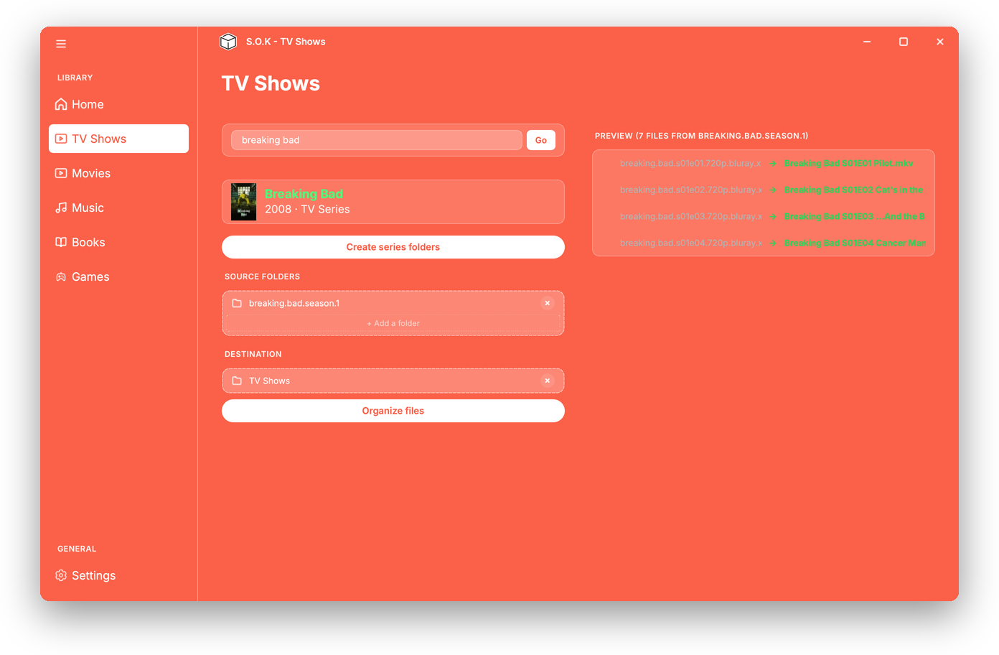
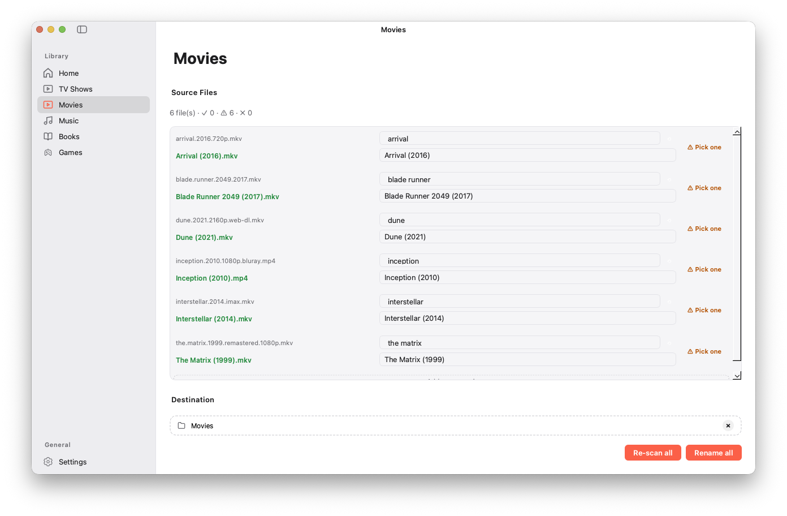
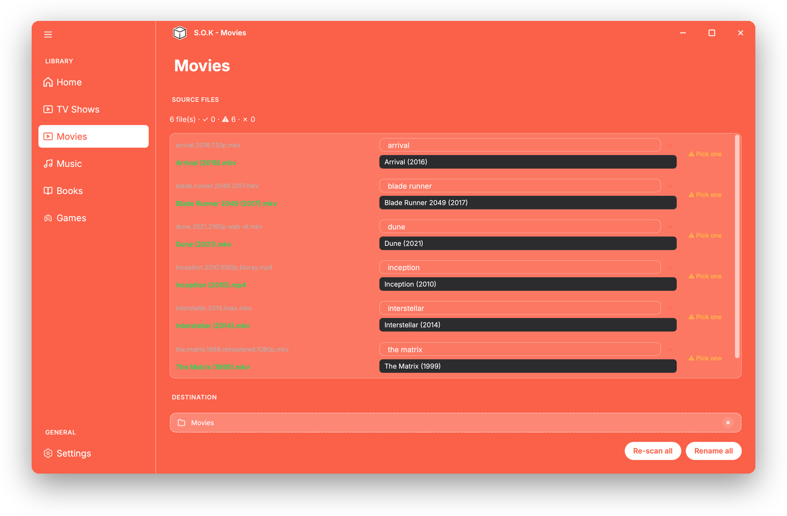
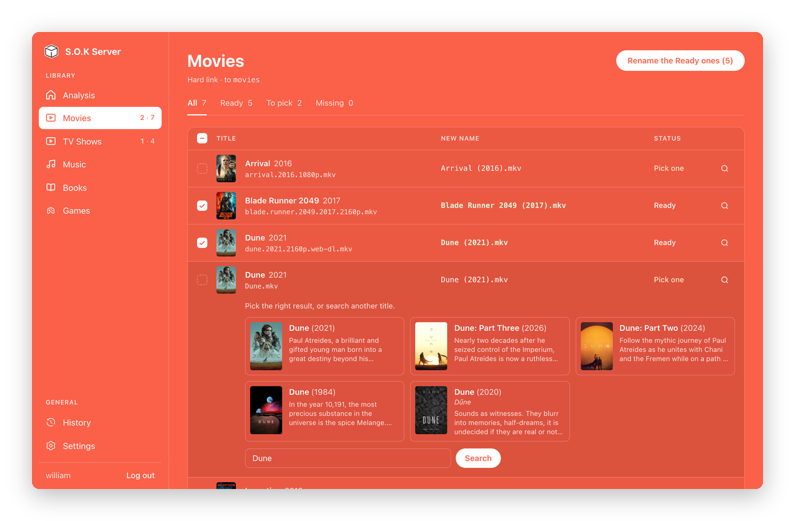
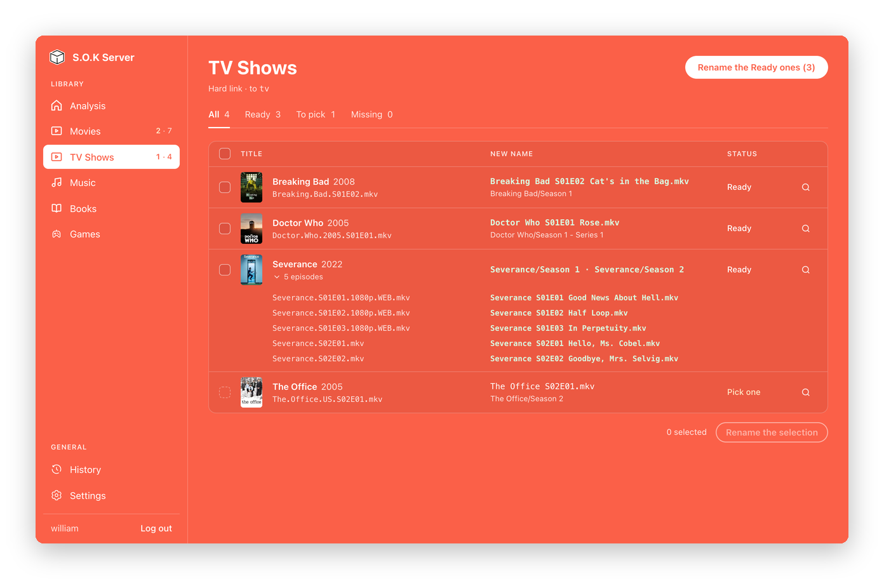

<div align="center">

# S.O.K - Storage Organisation Kit


**The ultimate assistant to tame your media library.**

[](https://github.com/SOKTeam/S.O.K/actions/workflows/ci.yml)
[](https://github.com/SOKTeam/S.O.K/releases/latest)


[Features](#-features) • [Download](#-download) •
[S.O.K Server](#-sok-server) •
[User guide](https://sokfromsokteam.vercel.app/guide) •
[Contribute](#-contribution)

</div>

---

## 👋 Why S.O.K?

Are you tired of folders named `New_Folder(2)`, files like
`breaking.bad.s01e01.720p.mkv`, or albums scattered across a dozen folders?

**S.O.K** (Storage Organisation Kit) was born from a simple need: to end
digital chaos. It identifies your movies, TV shows, music, books and video
games with specialized online databases, then renames and moves them into a
clean library that Plex, Jellyfin and Kodi understand.

It doesn't just move files: it understands what they are, and shows you a
preview of every new name before anything moves. Use it as an app on your
computer, or as **S.O.K Server**, a Docker image with a web interface for a NAS
or a home server.

---

## 📸 Screenshots

<!-- markdownlint-disable MD013 -->
<table>
  <tr>
    <th width="50%">macOS</th>
    <th width="50%">Windows &amp; Linux</th>
  </tr>
  <tr>
    <td><picture><source media="(prefers-color-scheme: dark)" srcset="docs/assets/screenshots/home-mac-dark.png"></picture></td>
    <td><picture><source media="(prefers-color-scheme: dark)" srcset="docs/assets/screenshots/home-linux-dark.png"></picture></td>
  </tr>
  <tr>
    <td colspan="2" align="center"><sub>Home page: drop anything, S.O.K sorts it by type</sub></td>
  </tr>
  <tr>
    <td><picture><source media="(prefers-color-scheme: dark)" srcset="docs/assets/screenshots/tv-shows-mac-dark.png"></picture></td>
    <td><picture><source media="(prefers-color-scheme: dark)" srcset="docs/assets/screenshots/tv-shows-linux-dark.png"></picture></td>
  </tr>
  <tr>
    <td colspan="2" align="center"><sub>TV shows: the preview of the new names</sub></td>
  </tr>
  <tr>
    <td><picture><source media="(prefers-color-scheme: dark)" srcset="docs/assets/screenshots/movies-mac-dark.png"></picture></td>
    <td><picture><source media="(prefers-color-scheme: dark)" srcset="docs/assets/screenshots/movies-linux-dark.png"></picture></td>
  </tr>
  <tr>
    <td colspan="2" align="center"><sub>Movies: one match per file</sub></td>
  </tr>
  <tr>
    <th colspan="2">S.O.K Server, in the browser</th>
  </tr>
  <tr>
    <td><picture><source media="(prefers-color-scheme: dark)" srcset="docs/assets/screenshots/server-movies-dark.png"></picture></td>
    <td><picture><source media="(prefers-color-scheme: dark)" srcset="docs/assets/screenshots/server-tv-dark.png"></picture></td>
  </tr>
  <tr>
    <td colspan="2" align="center"><sub>S.O.K Server: pick a result in the row, unfold a series</sub></td>
  </tr>
</table>
<!-- markdownlint-enable MD013 -->

---

## ✨ Features

### 🎬 TV Shows

Transform a messy folder of episodes into a media-server-ready series.

- **Smart detection**: guesses the series from the file names and reads the
  season and episode numbers (`S01E02`, `1x02`).
- **Clean structure**: `breaking.bad.s01e01.720p.mkv` ➔
  `Breaking Bad/Season 1/Breaking Bad S01E01 Pilot.mkv`.
- **Sources**: TMDB and TVDB.

### 🍿 Movies

Rename a whole folder of movies in one go.

- **One movie per file**: each file gets its own match, and you can correct any
  of them before renaming.
- **Your format**: `Dune (2021).mkv` by default, or add the quality with
  `{quality}` to get `Inception (2010) [1080p].mkv`.
- **Source**: TMDB.

### 🎵 Music

Rediscover your audio library.

- **Albums and loose tracks**: a whole album at once, or a batch of single
  tracks, renamed with your music format:
  `Daft Punk - Discovery/01 - One More Time.mp3` by default.
- **All the usual formats**: MP3, FLAC, M4A, OGG, Opus, WAV, AIFF, DSD…
- **Sources**: Deezer, MusicBrainz, Spotify and Last.fm.

### 📚 Books & Comics

Your digital library, finally sorted.

- **E-books and comics**: EPUB, MOBI, AZW3, PDF, FB2, CBZ, CBR and more.
- **A whole folder at once**: each book gets its own match, sorted into
  `Author/Author - Title (Year)/`.
- **Sources**: Google Books and Open Library.

### 🎮 Video Games

For ROM and ISO collectors.

- **Retrogaming ready**: disc images and cartridge ROMs, from NES to PS3.
- **Details kept**: sorted by platform, with the tags of the dump that ROM
  collections rely on: `Super Nintendo/Super Mario World (USA) (Rev 1).sfc`. A
  game of several files (a `.cue` and its `.bin`, several discs) gets its own
  folder.
- **Sources**: RAWG and IGDB.

### 🎨 And everywhere

- **Drop anything on the home page**: S.O.K sorts the files by type and opens
  the right page.
- **Only sure matches are Ready**: the title and the year (or the author, the
  artist) must match. The others wait for you to pick.
- **Undo**: every rename can be undone from the History page, all at once or
  file by file.
- **Move, hard link or copy**: a hard link leaves the original in place, so
  torrents keep seeding, without using more space.
- **Subtitles follow their video**: `Movie.fr.srt` becomes
  `Dune (2021).fr.srt` next to its movie.
- **Your naming rules**: change the name of every type in the settings, and
  describe how your own files are named so S.O.K reads them right.
- **Posters and covers** (optional): saved where Plex, Jellyfin and Kodi look
  for them.
- **8 languages**: English, French, German, Spanish, Italian, Portuguese,
  Russian and Polish, down to the folder names (`Season`, `Saison`,
  `Staffel`…).
- **Feels at home**: native window on macOS, its own title bar on Windows and
  Linux, light and dark themes.

> [!IMPORTANT]
> By default the app **moves** your files: they leave the source folder. Pick
> *Hard link* or *Copy* in the settings to keep them where they are. Check the
> preview before you confirm. A rename can be undone from the History page, as
> long as the files were not moved since.

---

## 📥 Download

| System | Package | Requirements |
| --- | --- | --- |
| 🪟 Windows | Installer (`.exe`) | Windows 10 or 11, 64-bit |
| 🍎 macOS | Disk image (`.dmg`) | Apple Silicon (M1 or later) |
| 🐧 Linux | AppImage (Intel/AMD, ARM) | Ubuntu 22.04, Debian 12, Fedora 35+ |

Grab the latest version from the
[download page](https://sokfromsokteam.vercel.app/download) or the
[GitHub releases](https://github.com/SOKTeam/S.O.K/releases/latest). The ARM
AppImage needs Ubuntu 24.04, Debian 13, Fedora 40 or newer.

No account or API key is needed for TV shows and movies: S.O.K works out of
the box, and tells you when a new version is available. New to it? The
[user guide](https://sokfromsokteam.vercel.app/guide) walks you through your
first organization.

---

## 🐳 S.O.K Server

The same engine, in a Docker image with a web interface, for a NAS or a home
server: point it at your download folders, review the proposed names in a
table, and rename everything at once or row by row. It uses **hard links** by
default, so torrents keep seeding. The interface looks like the app, with its
light, orange and dark themes.

Turn on the **automatic sorting** and it does it alone: every few minutes it
looks at your download folders, waits for each download to finish, and
renames what is Ready; the rest waits for you in the tables. After each
rename it can post to **Discord**, refresh **Jellyfin** or **Plex**, call a
**webhook**, or run a **script**.

Try it first in the [live demo](https://sokfromsokteam.vercel.app/demo): the
real interface with an example library, in your browser, nothing to install.

```yaml
services:
  sok-server:
    image: ghcr.io/sokteam/sok-server:latest
    environment:
      - PUID=1000
      - PGID=1000
      - TZ=Europe/Paris
    volumes:
      - /srv/sok/config:/config
      - /mnt/storage:/data # one parent folder: hard links work inside it
    ports:
      - 8080:8080
    restart: unless-stopped
```

Open `http://<your-server>:8080`, create your account, then add your folders
and API keys in the settings. The image runs on Intel/AMD and ARM (`amd64`,
`arm64`).

> [!TIP]
> A hard link only works inside one mount: mount the common parent of your
> downloads and your library once (`/mnt/storage:/data`), not each folder on
> its own.

The [user guide](https://sokfromsokteam.vercel.app/guide/server) explains the
installation, the folders, the keys, the renaming, the automatic sorting and
the notifications.

---

## 🚀 Run from source

We use [uv](https://docs.astral.sh/uv/) for an ultra-fast setup. You need
Python 3.13.

```bash
# 1. Clone the project
git clone https://github.com/SOKTeam/S.O.K.git
cd S.O.K

# 2. Install the dependencies (creates the virtual environment)
uv sync --extra dev

# 3. Add your API keys (Deezer, MusicBrainz and Open Library need none)
cp .env.example .env

# 4. Launch the application
uv run sok
```

---

## 💻 For Developers

S.O.K is built in layers you can reuse in your own scripts:

- `src/sok/apis`: one connector per database (TMDB, Deezer, IGDB…).
- `src/sok/core`: the media manager that picks the right API for each search.
- `src/sok/file_operations`: name parsing, renaming and moving.
- `src/sok/ui`: the PySide6 interface.
- `src/sok/server` and `web/`: S.O.K Server, a FastAPI application and its
  Svelte interface.

```python
import asyncio

from sok.apis.music.deezer_api import DeezerApi
from sok.core.interfaces import ContentType


async def main():
    async with DeezerApi() as api:
        response = await api.search("Discovery", ContentType.ALBUM)
        for album in response["results"][:3]:
            print(album["title"], "-", album["artist"])


asyncio.run(main())
```

The [developer documentation](docs/index.md) covers the architecture, adding a
database, translations and building the Windows, macOS and Linux packages.

---

## 🛠️ Roadmap

**✅ Available**

- Movies, TV shows, music, books and games
- Windows, macOS (Apple Silicon) and Linux (AppImage) apps
- Built-in updates
- Automatic detection of the media type
- A more reliable "Ready" status: the title and year must match
- History of renamed files, with undo
- Move, hard link or copy; subtitles follow their video
- **S.O.K Server**: a Docker image with a web interface in the look of the
  app (light, orange and dark themes), hard links by default, several
  destination folders per media type, files already processed left out
- S.O.K Server sorts new files automatically once downloaded, then notifies
  Discord, Jellyfin, Plex, a webhook or a script

**➡️ Next**

- Several user accounts on S.O.K Server

---

## 🤝 Contribution

Open Source is at the heart of this project. Have an idea? Found a bug?

1. Take a look at the [Issues](https://github.com/SOKTeam/S.O.K/issues).
2. Fork the project.
3. Create your branch from `develop` (`git checkout -b feat/super-feature`).
4. Submit your Pull Request!

Check out our [Contribution Guide](CONTRIBUTING.md) for the commit
conventions and the checks to run.

---

<div align="center">

**Made with ❤️ by the S.O.K Team**

MIT License © 2026

</div>
